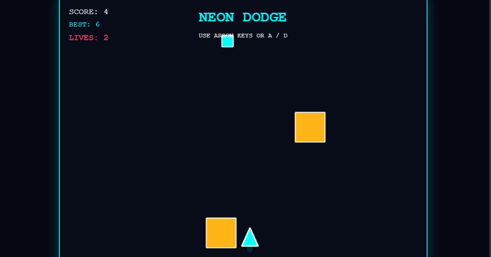
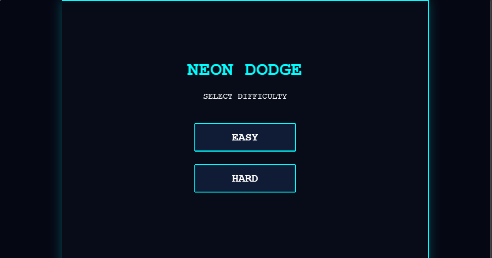
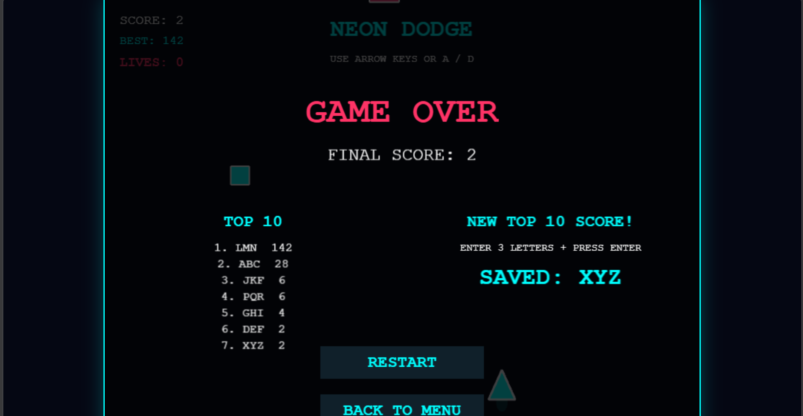
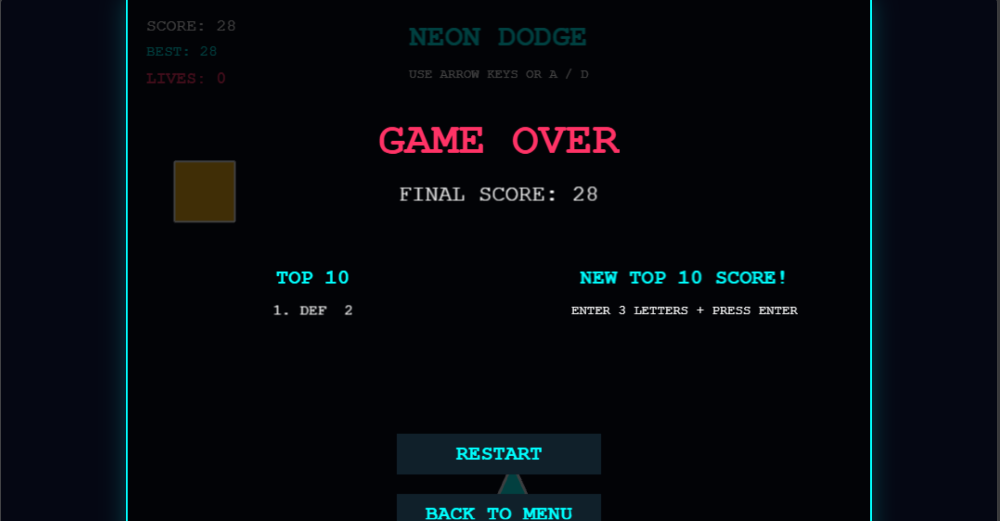

# ⚡ Neon Dodge

**A neon-themed arcade survival game built with Phaser, TypeScript and Vite.**

Dodge incoming obstacles, survive as long as possible, and beat your highest score. Choose your difficulty, improve your reflexes, and climb the leaderboard.

<p align="center">
  <a href="https://outduke.github.io/AI-Game-Factory/">
    <strong>🎮 PLAY NEON DODGE</strong>
  </a>
</p>

## Screenshots

### Gameplay


### Start Screen


### Leaderboard


### Game Over


## Features

- Neon-themed visuals and particle effects
- Player movement using keyboard and mouse
- Easy and Hard difficulty modes
- Obstacle spawning and collision detection
- Lives and scoring system
- Progressive difficulty
- Pause, resume and restart
- High-score tracking and Top 10 leaderboard
- Sound effects with mute controls
- Offline support

## Controls

| Key | Action |
|---|---|
| Arrow Keys / WASD | Move |
| Mouse | Move player |
| P / Escape | Pause |
| R | Restart |
| V | Toggle sound |
| M | Return to menu |

## Tech Stack

- **Language:** TypeScript
- **Game Framework:** Phaser
- **Build Tool:** Vite
- **Styling:** CSS
- **Deployment:** GitHub Pages

## Run Locally

Make sure you have Node.js installed.

```bash
git clone https://github.com/OutDuke/AI-Game-Factory.git
cd AI-Game-Factory
npm install
npm run dev
```

Open the local URL displayed by Vite.

## Production Build

```bash
npm run build
```

The production files will be generated in the `dist/` directory.

## Play Online

https://outduke.github.io/AI-Game-Factory/

---

**Built as a personal game development project.**