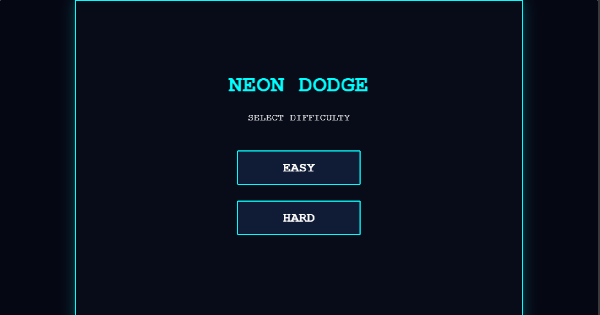
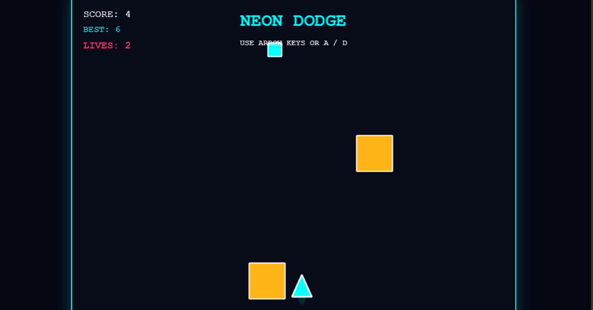

# Neon Dodge

Neon Dodge is a browser-based arcade survival game built with Phaser and TypeScript.

## How to Play

- Avoid incoming obstacles.
- Survive as long as possible.
- Earn points and aim for the Top 10 leaderboard.

## Controls

| Key / Input | Action |
|---|---|
| A / D or Arrow Keys | Move |
| Mouse / Touch | Move the player |
| P / Escape | Pause / Resume |
| V | Toggle sound |
| R | Restart after Game Over |
| M | Return to Main Menu |

## Features

- Easy and Hard difficulty modes
- Three lives
- Pause menu
- Sound toggle
- Persistent Top 10 leaderboard
- Collision particles and screen effects
- Progressive difficulty
- Offline support

## Run Locally

Requirements: Node.js and npm.

```bash
npm install
npm run dev
```

To create and preview a production build:

```bash
npm run build
npm run preview
```

## Technology

- Phaser
- TypeScript
- Vite


## Screenshots

### Start Screen


### Gameplay


### Leaderboard


## Play Online

[Play Neon Dodge](https://outduke.github.io/AI-Game-Factory/)
